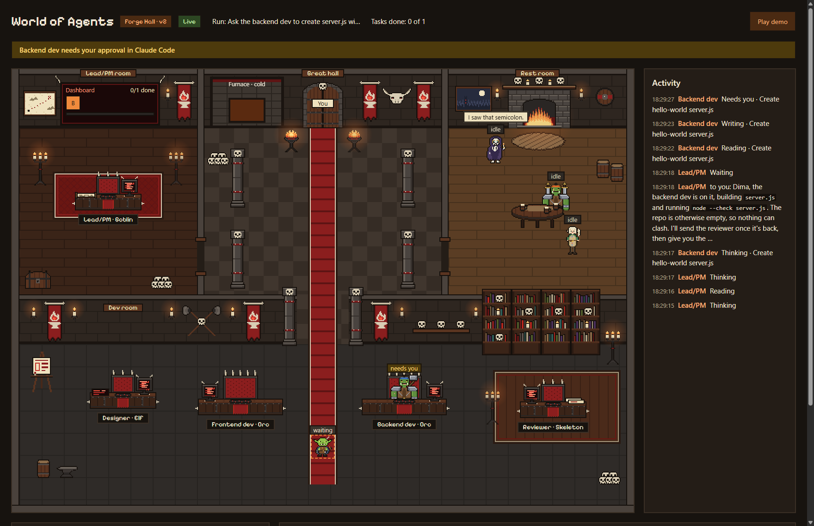
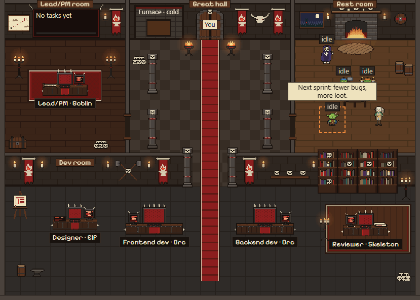

# World of Agents

A pixel-art hall where you watch five AI agents work on your code.

You run Claude Code in your project. A team of five does the work: Lead/PM, Designer, Frontend dev, Backend dev and Reviewer. A web page shows each of them walking to a desk, reading, writing and waiting for your approval.

**[Try the demo](https://kremendev.github.io/world-of-agents/).** It is a scripted run in your browser. It needs no setup and calls no AI.



A recorded run, played back at twice the speed:



## New in v3

v3 brings the team into the Claude desktop app. Installed as a plugin in one project, it adds:

- **The guard.** A hook that can only deny: an agent start outside the team's table, Claude Code's own agents included, and a shell command that names a `.env` or `.envrc` file.
- **The setup skills.** `/world-of-agents:setup-project` shows, and `/world-of-agents:setup-project-write` writes, Manual mode, subagent depth 2 and a safe-command list for that project. A project set up by an earlier version is upgraded.
- **The team pane.** Beside the conversation: what each agent is doing, who waits for your approval, a warning when nothing asks before acting or when the plugin is on for every project, your context and plan limits, three preset prompts and the link to the hall.
- **A hall that starts itself.** The plugin carries a prebuilt hall and starts it at your first message: no `npm run hall`, no clone and no `npm install`.
- **A voice on Windows.** "Backend dev needs your approval." and "The team is done." out loud, muted with one click.

The guard now denies Claude Code's built-in agents, which v2 never checked. That change in behaviour is why this is a major version. The details are in the [release notes](docs/release-notes/v3.0.0.md), and each part has its own section under [Install as a plugin](#install-as-a-plugin).

## Requirements

- **Claude Code 2.1.312 or later**, the CLI or the Claude desktop app's Code tab, logged in with your Claude plan. Older versions refuse the team pane or weren't tested with it. Works on Pro. Max recommended for guild runs, because they use the plan faster. [Install it](https://code.claude.com/docs/en/quickstart) if you don't have it. Runs count against your plan's limits, and claude.ai shares those limits.
- **Requires Node.js 20.19 or later on PATH.** Tested on 24.22.0. The plugin's hooks run on it, and the guard fails closed: without Node, every agent start and every Bash or PowerShell command in a project with the plugin is blocked with `hook error: [node ${CLAUDE_PLUGIN_ROOT}/hooks/guard.mjs]: failed; blocking because onFailure is "block" Error occurred while executing hook command: Executable not found in $PATH: "node"`. Install Node, or turn the plugin off for that project: `claude plugin disable world-of-agents@world-of-agents --scope local` in the project folder.
- **On Windows:** Git Bash (it comes with Git for Windows), for `woa`, which is a bash script, and for the setup skills: Claude Code runs their fixed command through Git Bash, and nobody has tried them without it. The voice uses Windows' own speech synthesizer, so it speaks on Windows only. Claude Code has no sandbox on native Windows (see Known limits).

Tested on Windows 11. Claude Code 2.1.312 and 2.1.319 load the plugin and pass the pane's own tests (`claude plugin validate` and `claude plugin test`), and the desktop app was checked with its engine at 2.1.321. v3.0.0 also ran on 2.1.299, but from v3.0.1 the pane reads one setting with a call nobody has tried on versions before 2.1.312; 2.1.295 and 2.1.296 refuse the pane.

## Setup

```bash
git clone https://github.com/kremendev/world-of-agents.git
cd world-of-agents
npm ci
```

Put `woa` on your PATH, so you can start it from any project. Run this once, in the same folder:

```bash
echo "export PATH=\"\$PATH:$PWD/bin\"" >> ~/.bashrc
source ~/.bashrc
```

The next time you open Git Bash, it may print a red warning about `~/.bash_profile` and create that file. That is fine, and it only happens once.

Check that it reaches Claude Code. This prints a version and starts nothing:

```bash
woa --version
```

## Run it

Use two terminals.

**Terminal 1: the hall.** In this repo:

```bash
npm run hall
```

Open http://127.0.0.1:4319. The badge says Live. To see the scripted run, press **Play demo**. **Back to live** returns to the real one.

**Terminal 2: Claude Code.** In your own project:

```bash
cd path/to/your/project
woa
```

Type your task in Claude Code, and the hall follows it. You approve edits and commands in the terminal, never in the page.

Press Ctrl+C in terminal 1 to stop the hall.

## Install as a plugin

`woa` is for the terminal. To use the team in the Claude desktop app, or in any Claude Code session, install the plugin. Up to v2.2.0 you still need the setup above and `npm run hall` running, because the plugin only reports to the hall. From v3.0.0 the plugin carries a prebuilt hall and starts it itself, so you need neither.

**1. Add the marketplace.** You do this once on each PC, and it turns nothing on. In a Claude Code session:

```text
/plugin marketplace add kremendev/world-of-agents#v3.0.1
```

Or in a terminal:

```bash
claude plugin marketplace add kremendev/world-of-agents#v3.0.1
```

**2. Install it for one project only, from a terminal.** In the project folder:

```bash
claude plugin install world-of-agents@world-of-agents --scope local
```

Don't install it through the desktop app's Plugins screen. On 11 Nov 2026 (app 5.1231) that screen asked for no scope and installed the plugin for every project, twice. Then check:

```bash
claude plugin list
```

No `world-of-agents` entry may say `Scope: user`. The list shows every project's install, each with its status in the folder you run it from. If one says `Scope: user`, run `claude plugin uninstall world-of-agents@world-of-agents --scope user`, then install it again in each project.

**Never install it at user scope.** The Lead/PM becomes the main agent wherever the plugin is enabled, so every session in every project would start as the Lead and report to the hall. Project scope is only for a team: it writes to `.claude/settings.json`, which you commit, and turns the plugin on for everyone who clones the repo.

**3. Check the permission mode says Manual.** The selector is under the prompt box. `woa` always starts in Manual, but an installed plugin can't choose a mode. In Auto, nothing asks for your approval, so the hall never shows "needs you".

From v3.0.0 the plugin does this for you, once per project, in two steps you type yourself. `/world-of-agents:setup-project` shows what it would write into the project's `.claude/settings.local.json`: Manual mode, subagent depth 2 and a safe-command list, plus a `.gitignore` line for that file. It writes nothing. `/world-of-agents:setup-project-write` then writes exactly that; typing it is your yes. Claude Code runs a fixed script from the plugin for both, and the model can't start either one. Run again, it says "Already set up". A file set up by an earlier version of the plugin is upgraded: the dry run names the version and the rules it adds and removes, and every other setting in the file stays as it is. From v3.0.1, rules you added yourself, such as the one an "Always allow" click adds, stay too: the dry run lists them, and the upgrade keeps them after the template's own. The same goes for a first setup in a project that already has such rules, as long as `permissions` holds nothing but its `allow`, `deny` and `ask` lists. If one of the template's rules is missing or changed, or the file holds anything else, nothing changes and you're told which settings differ (names only, never values). The settings apply from the next new session. With `woa` it works now. In the desktop app, check the selector in the first new session after the setup. In our tests the app used this file's Manual only in a git repository; in a folder without git it started in your own default mode instead. A mode you pick in the selector also sticks to that folder and wins over the file in later sessions. If it doesn't say Manual, pick Manual once, and the app remembers it for that folder. The pane warns when it says Auto.

**The team pane.** From v3.0.0 the plugin also draws a pane beside the conversation: the five agents with their state and task, who is waiting for your approval, a warning in the modes that don't ask before acting (Auto, Bypass permissions) or before edits (Accept edits), how full the context is and how much of your plan's limits is used, three preset prompts ("Plan the next milestone", "Run the quality check", "Review what changed") and an "Open hall" link. A preset puts its prompt in the prompt box, after anything you've already typed, and you send it with Enter: the pane never sends a prompt itself. It appears after you send the first message, because that is when the session, and with it the pane, starts. If you close the pane, `/world-of-agents:team` opens it again. Only you can run that command, and it costs no plan: the pane answers it, so it never reaches the model. From v3.0.1 it also warns "World of Agents is on for every project." when your user settings turn the plugin on, and gives the command that turns it off there: `claude plugin disable world-of-agents@world-of-agents --scope user`. Projects where you installed it with `--scope local` keep it.

**The hall starts itself.** At your first message the pane checks that Node.js 20.19 or later is on PATH (and warns if not), then starts the hall the plugin carries, unless one is already running. It checks again at each of the Lead's turns and starts it again if it's gone. "Open hall" shows only once the hall has proved it holds the token, the same handshake the hook script uses, so the link never points at another program. If another program holds port 4319, the pane says "Port 4319 is used by another program." and starts nothing.

**The voice (Windows).** The pane says two things out loud: "Backend dev needs your approval." when an agent waits for you, and, once the team has finished and the Lead has answered, "The team is done." with the first sentence of that answer, or "The team stopped. Backend dev failed." It uses Windows' own speech synthesizer through a fixed script, `plugin/voice/speak.ps1`, started as `powershell.exe -NoProfile -NonInteractive -ExecutionPolicy RemoteSigned -File …`. The text goes in on stdin, never into the command. `RemoteSigned` applies to that one process and changes nothing on your PC: it runs the plugin's own local script and refuses one marked as downloaded from the internet. If a Group Policy sets the execution policy, it wins, and the voice stays silent. **Mute voice** in the pane turns it off, and it stays off in later sessions.

The safe-command list lets `npm test` and `npm run check` run without asking, so they run whatever code the project's scripts, tests, configs and setup files hold. Read every edit approval in Manual mode as carefully as a command. If the path to the plugin's folder holds an apostrophe, the two skills can't run: Claude Code stops with "Shell command failed … unexpected EOF while looking for matching" and nothing happens.

To turn it off, or any one part of it, see [Turn it off](#turn-it-off).

You can still run `woa` in a project that has the plugin. For that session, `woa`'s copy replaces the installed one, so nothing loads twice.

## What the hall shows

- The Lead/PM walks to the dashboard, and each task it hands out becomes a card.
- Each agent fetches its scroll from the Lead's room, then goes to its desk.
- Agents read and write at their desks. The orcs smash their keyboards.
- The furnace burns brighter the more agents are working.
- When Claude Code asks for your approval, the agent shows "needs you" and an orange banner names it.
- A finished agent's card moves to Done, and it walks to the rest room, where it shows the first sentence of its last message. A bubble never rides along with a walking agent: it waits until the agent stops.
- The Reviewer reads the work, and the Lead's report shows as a message to you.
- The activity feed lists every step with its time. Click an agent to see only that agent. A long message shows cut: "Show all" opens the whole text under it, where you can select and copy it, and a click on the row works too. Messages to you, approval waits and failures stand out with a border and a label ("To you", "Needs you", "Failed"), decided by the kind of event, never by what the text says.

## What it never does

- **No API key.** Claude Code runs on your own login. There is no key anywhere in this project.
- **It never reads your login.** That is also why it can't check which plan you have.
- **It never starts a run.** No endpoint starts or runs anything.
- **It never sends anything as you.** Neither the page nor the pane sends a prompt: a preset only puts its text in your prompt box, and you press Enter.
- **It never approves anything.** The guard can only deny, and the pane never answers a tool call, a permission check or an agent start, so your approval prompt always decides.
- **It never reads your `.env` files.** No part of the plugin opens one. The guard denies an agent's shell command that names a `.env` or `.envrc` file, and the setup adds denies that cover Claude Code's file tools and the file commands it recognises in shell commands, like `cat`, `head` and `tail`. They don't cover `grep -r` over a folder, or a script that opens files itself. Both are best effort (see the guard below).
- **The page only watches.** Nothing you do in the page reaches an agent.
- **Events stay in memory on 127.0.0.1.** The hall listens on that address only, keeps the last 500 events and forgets them when it stops. Nothing goes to any other computer.

The hook script sends the hall a short list of fields: event name, ids, agent type, tool name, task titles, the start of your prompt (120 characters) and the agents' last messages (up to 20,000 characters each). Those messages are the agents' own words, so they can quote code or a command an agent wrote. It never sends a tool's input or result, file contents or transcripts. It replaces your home folder and anything shaped like a key before sending. It drops any reply, so the hall can't steer Claude Code.

`woa` adds nothing to your project. Installing the plugin adds one line to the project's `.claude/settings.local.json`, which git ignores. The setup skills, only when you type them, add the settings above to that file and a line for it to `.gitignore`. The hall writes one file, `~/.world-of-agents/token`: a random token that lets your hooks post events. It is not your Claude login. The hall deletes it when it stops, but a PC shutdown can leave it behind. That is harmless: the hook script posts nothing until the hall proves it holds the token. An installed plugin has this check from v2.2.0.

One hook answers Claude Code: the guard, `plugin/hooks/guard.mjs`. It runs before every agent start and every Bash or PowerShell command, and it can only deny, never allow, so your permission prompt still decides. It denies an agent start outside the team's table (only the Lead starts agents, and only the four others; Claude Code's own agents are denied, because some run on Haiku), and a shell command that names a `.env` or `.envrc` file. The `.env` rule is best effort: it stops accidents and lazy prompt injection, not someone set on getting around it. If the guard can't read a call, it denies it, and a guard that crashes or hangs blocks the call too. An installed plugin has it from v3.0.0, and `woa` has it too.

The team pane (`plugin/hooks/mod/`) runs inside Claude Code and only watches. It never answers a tool call, a permission check or an agent start, and it never sends a prompt: a preset button only puts its fixed text in your prompt box, after what you've typed. It never reads your draft. Of the messages you send, it only checks whether one carries an agent's result, and it keeps none of their text. Agent text shows as plain text, never as Markdown or a link; its one link goes to the hall on localhost. It uses no network and no files. Of your settings it reads one key, `enabledPlugins` in your user settings, to warn when the plugin is on for every project, and nothing else of them. It starts only fixed programs, each from the plugin's own folder, with no shell and no argument from an agent, a file or the page: `node --version`, `node hooks/hall-check.mjs` (what holds port 4319?), `node hall/server.mjs` (the hall) and the voice script. Nothing they print is shown or kept. `npm run check` lists every event and API call it uses and fails if that list changes, so any change to it shows in review.

The hook script has one debug switch. `WOA_CAPTURE=1` saves raw hook payloads, which can hold file contents and commands, to `~/.world-of-agents/capture/`. `woa` always turns it off, so normal use never saves them.

## Turn it off

- **In one project:** run `claude plugin disable world-of-agents@world-of-agents --scope local` in the project folder. In a project where you installed it with `--scope local`, the desktop app's switch under Customize, then Plugins, does the same: on 11 Nov 2026 (app 5.1231.2) it wrote that project's `.claude/settings.local.json` and left your user settings alone. The agents, the guard, the pane, the hall and the voice all go with it. `claude plugin enable world-of-agents@world-of-agents --scope local` turns it back on.
- **The voice only:** press **Mute voice** in the pane. It stays muted in later sessions.
- **The pane only:** close it. `/world-of-agents:team` opens it again.
- **The hall:** it stops when the session that started it closes or the plugin reloads. A hall you started with `npm run hall` stops with Ctrl+C.
- **The setup's settings:** disabling or removing the plugin leaves them in the project's `.claude/settings.local.json`. Delete `permissions` and `env.CLAUDE_CODE_MAX_SUBAGENT_SPAWN_DEPTH` there to remove them.
- **For good:** run this in the project folder:

```bash
claude plugin uninstall world-of-agents@world-of-agents --scope local
```

## Known limits

- **Approval flags follow a few rules.** `PermissionRequest` names the agent asking, right away.
  - No hook says when you answered, so the flag clears at that agent's next event.
  - If a session sends no `PermissionRequest` (the hall started mid-wait, or an older Claude Code), the hall guesses after about 6 s: the running subagent that last used Edit, Write or Bash. With two writing at once it can name the wrong one.
  - Once a `PermissionRequest` has arrived in a session, the hall never guesses. If a later one gets lost, that wait shows no flag.
- **The pane's approval list.** An approval stays listed until that call finishes, so a long command stays there while it runs after you approve it. The mode warning can come one prompt late: Claude Code says nothing when you switch modes, so the pane learns the mode from the next prompt or agent start.
- **No token counts.** Hooks don't report them.
- **No sandbox on native Windows.** Commands run with your user's rights, so your approval is the guard. Read each command before you approve it. Claude Code's sandbox needs macOS, Linux or WSL2.
- **One session at a time.** The hall follows one session. Starting, clearing or resuming a session takes it over.
- **The desktop app's mode can beat Manual.** In our tests the app used the setup's Manual only in a git repository; in a folder without git it used your own default mode. A mode you pick in the selector also sticks to that folder and wins over the file. Check the selector in the first new session, and if it doesn't say Manual, pick Manual once: the app remembers it for that folder. The pane warns in Auto, Bypass permissions and Accept edits.
- **The pane's hall lives with your sessions.** A hall the pane started stops when its session closes or the plugin reloads. With two sessions open, closing the one that started it costs the other one turn without a hall. The desktop app can also move a session to a fresh Claude Code process when you come back to it; if the old process goes, its hall goes too. The next Lead turn starts a new one. A restarted hall remembers nothing from before, and the page says "Hall restarted" until your next prompt. A later version plans a hall that runs on its own and stops itself after about 30 idle minutes.
- **Port 4319 is fixed.** If another program holds it, the pane starts no hall.
- **Apostrophes in the plugin's path.** The setup skills put the plugin's path in single quotes. One apostrophe in it makes them fail safely, as above. Two balance the quotes again, so the shell reads the text between them unquoted: it splits the path there, and a `$(...)` in that text would run. Only the names of your own folders reach that path, never a project's or the conversation's, so keep apostrophes out of the folders above the plugin, your user folder included.
- **Where an organization manages Claude Code.** If its managed settings turn on `allowManagedHooksOnly`, a plugin you install yourself loads no hooks. The agents and the Lead still load, but with no guard, no team pane and no reports to the hall, so nothing denies what the guard would. Claude Code's own mods API reference (2.1.318) says so; it hasn't been tested. The validators of 2.1.299 to 2.1.301 also warned that the pane's `classic.*` hooks don't run where an organization manages Claude Code, which would leave the pane without its approval list, the approval voice and the mode warning. Later validators no longer print that warning.
- **The voice is Windows only.** Elsewhere the pane stays quiet.
- **Tested on Windows only.** `woa` may work on macOS and Linux, but nobody has tried it.

Work on a git branch, and commit before a run. Review the diff before you commit what the agents wrote.

## How it's built

```text
Claude Code in your project, with the plugin
    │ hook events, as JSON on stdin
    ▼
Hook script: keeps allowed fields, scrubs them, drops any reply
    │ POST /api/hook, with the token
    ▼
Hall server, 127.0.0.1:4319: checks token, Host and Origin, turns hooks into events
    │ Server-Sent Events, read only
    ▼
Page: checks every event, draws the hall
```

- **Plugin** (`plugin/`): the five agents and the hooks. The Lead runs on Opus and the team on Sonnet. Each agent gets only the tools its job needs, and the Reviewer only reads. The repo is its own marketplace (`.claude-plugin/marketplace.json`).
- **Hook script** (`plugin/hooks/send.mjs`): uses Node built-ins only, always exits 0 and prints nothing.
- **Team pane** (`plugin/hooks/mod/`): a Claude Code mod in TypeScript, typed against the engine's own types for one Claude Code version (`tools/claude-code-types/`, refreshed only with `npm run types:update`) and tested with Claude Code's own kit.
- **Hall server** (`server/`): plain `node:http`, run with `tsx`. It also serves the page: only the files the build lists, never a path taken from the URL.
- **Prebuilt hall** (`plugin/hall/`): the page and one bundled server file that imports only Node's built-ins, so an install needs no `npm install`. `npm run build:plugin-hall` writes it and git tracks it. `npm run check:hall` builds it again and fails if anything differs; every release runs it first (`npm run release:check`).
- **Page** (`src/`): React and TypeScript, with the hall drawn on Canvas 2D. Agent text only ever shows as plain text, and a Content-Security-Policy stops the page loading anything but its own files. The demo plays the same events from a script.
- **Launcher** (`bin/woa`): starts Claude Code with the plugin, the Lead and approvals on.

To work on the page, run `npm run dev` (http://localhost:5173). Run `npm run check` before you commit. It needs Claude Code on PATH, because it runs the pane's tests and reads the pane with `claude plugin test` and `claude plugin validate`. The plan and the real hook payloads are in [docs/v2-brief.md](docs/v2-brief.md) and [docs/v2-hooks.md](docs/v2-hooks.md).

## Credits and license

All art is original, drawn for this project. The only third-party asset is the [Pixelify Sans](https://fontsource.org/fonts/pixelify-sans) font (SIL Open Font License 1.1), installed from npm, so the page makes no requests to Google Fonts.

MIT. See [LICENSE](LICENSE).
